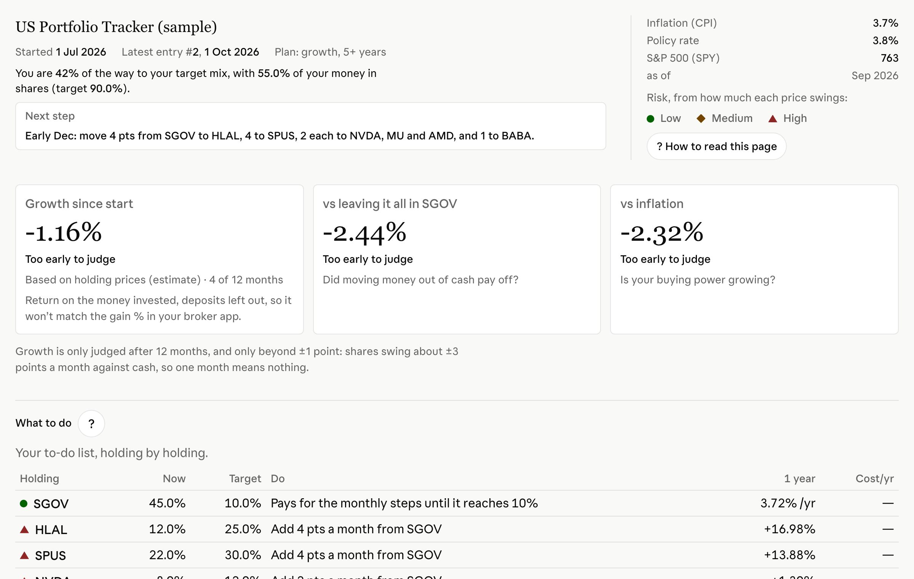
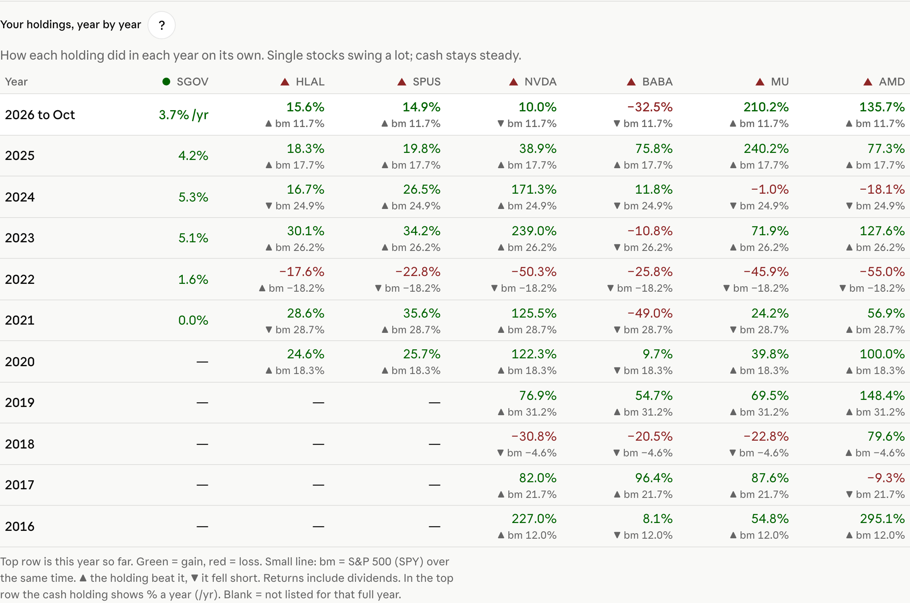

<div align="center">

# Portfolio Tracker

**A Claude Code skill that keeps one investment account on plan.**<br>
It logs every change, tracks a target mix, pulls monthly figures, tells you the next concrete step,<br>
and builds a private claude.ai dashboard that answers *"am I doing well, and what next?"*

</div>

<picture>
  <source media="(prefers-color-scheme: dark)" srcset="docs/images/dashboard-dark.png">
  
</picture>
<p align="center"><sub>The bundled sample account (<code>examples/us-sample/</code>). The allocations are made up; the market figures are real.</sub></p>

> [!IMPORTANT]
> Not financial or tax advice. The skill follows rules you agree with it; you decide what to do with your money.

## Features

- **Any holdings.** Stocks, ETFs and mutual funds, in any currency: one account and one currency per folder.
- **A plan, not just a chart.** You agree a target mix once; every update shows how far along you are and the one next step (date, holding, points, from which holding).
- **Rules-based advice.** Target mix, drift bands, buying risky holdings in monthly steps. Specific picks only when you ask, with sources.
- **Honest scoring.** Growth since start, against leaving it all in cash, and against inflation. No verdict before 12 months, because one month of share prices means nothing.
- **Private by design.** Git holds percentages only. Amounts are optional and stay in a gitignored `private/` folder.
- **A dashboard you control.** A private claude.ai artifact, light and dark, phone and desktop. It changes only when you say "publish".

## Requirements

- [Claude Code](https://claude.com/claude-code)
- For the dashboard only: Claude Code signed in to a claude.ai account with artifacts enabled. Tracking, updates and advice work without it.
- Python 3 and Node.js
- Git

## Install

```bash
git clone https://github.com/Usmansagemode/portfolio-tracker.git ~/.claude/skills/portfolio-tracker
```

Claude Code picks up skills in `~/.claude/skills/` on its next start. To update later, `git pull` in that folder.

## Quick start: track a new portfolio

**1. Make a folder for the account and open Claude Code in it.**

```bash
mkdir -p ~/Documents/Portfolios/family-isa && cd ~/Documents/Portfolios/family-isa && claude
```

**2. Ask for a tracker.**

```text
Set up a portfolio tracker for this account.
```

New to investing? Say that instead, e.g. *"I want to start investing, I live in the UK"*.

Claude asks a few plain questions in one message. Skip any of them or say "not sure"; it fills in sensible defaults and tells you which it used.

| It asks | For example |
|---|---|
| Where you live, or the currency | UK, or GBP |
| Whether you already invest, and in what | "VWRL 60%, IGLT 40%", a screenshot from your app, or "nothing yet" |
| What the money is for, and when you might need it | "a house deposit in 8 years" |
| How you'd react to a 20% drop | hold on, worry, or sell |
| Any rules or ideas | Shariah-compliant only, or "I keep hearing about Nvidia" |
| Amounts, or percentages only | percentages only shares nothing about how much you have |

If you have no plan yet, it recommends a starting mix that you can buy in your country, with the evidence for each pick, and checks any stocks you mentioned. You accept it or change it. It also lists the technical settings (the cash holding, the benchmark, a tax rate for estimates) with a default for each. Accept them, change them, or ask what any of them means.

Then it creates the folder's files (git, a gitignored `private/` folder, a commit guard), checks each ticker, loads price history and builds the page.

**3. Publish the dashboard.**

```text
publish
```

Claude creates the artifact on your claude.ai account and gives you the link. To let someone else see it, use **Share** on claude.ai. Anyone you share it with sees everything on the page.

> [!TIP]
> **Tracking someone else's money too?** Give each account its own folder, for example `~/Documents/Portfolios/mine` and `~/Documents/Portfolios/partner`. Each folder has its own log, plan and dashboard, and the accounts never mix.

## Everyday use

Say it in your own words; these are examples.

| You say | Claude |
|---|---|
| "Here's my holdings screenshot" | Reads it, updates each holding's %, works out the return since the last snapshot |
| "I moved 5% from cash into VWRL" | Logs the change and rewrites each holding's next step |
| "Update the tracker" | Fetches the latest month's figures and says what changed |
| "What should I do next?" | The one next step, from the plan's rules |
| "What should I hold for a 10-year goal?" | Specific holdings with sources and a not-advice line |
| "What's one point worth?" | Amounts in chat, if you chose to keep amounts |
| "Show amounts on the dashboard" / "go back to percentages" | Switches how amounts are tracked; history stays |
| "publish" | Sends only what changed to the dashboard |

## The dashboard



From top to bottom:
- progress to the target mix and the next step
- three growth tiles
- **What to do**: now, target and action per holding, with 1-year return and cost
- now vs target
- growth since start
- each holding year by year
- total gain since each year
- allocation history
- the log

Every section has a **?** button that says what it shows and how to read it. Holdings are always listed from low to high risk: ● Low, ◆ Medium, ▲ High.

## Privacy

| Where | Holds |
|---|---|
| Git (the account folder) | Percentages, the log, monthly figures. Never amounts. |
| `private/` (gitignored, owner-only) | Amounts from screenshots and deposits, if you chose to keep them. Optional API keys. |
| The claude.ai dashboard | Percentages. Totals (value, gain, 1 point) only if you chose "dashboard". |

A pre-commit hook refuses to commit `private/`, `.env` files, or anything that looks like an amount: digits after the account's currency symbol or code (`$5000` or `USD 5000` in a US account) or with two or more thousands separators (`12,345,678`). A bare number like `5000` gets through, so keep amounts out of the log by habit too. Amounts appear in chat only when you ask.

## Data sources

| Source | Covers | Notes |
|---|---|---|
| `prices` | Anything with a ticker | Free Yahoo prices and FRED inflation and rates; an optional Alpha Vantage key. These are unofficial and can change without notice. |
| `ubl-fmr` | UBL / Al-Ameen funds, Pakistan | UBL's monthly fund report |

Country notes (inflation, trading, tax) exist for the US and Pakistan; other countries work without one. Outside the US, inflation updates automatically only if FRED carries your country's series; otherwise the monthly inflation figure is entered by hand from the official release. To add your own: [`references/adding-a-source.md`](references/adding-a-source.md), [`references/adding-a-country.md`](references/adding-a-country.md).

## How it works

```text
SKILL.md              what Claude follows: setup, updates, snapshots, rules
scripts/              prices, fund-report parser, page build, calc check, money view, commit guard
templates/            the dashboard page and its wording
references/           file formats, publishing, recommending, sources, countries
examples/us-sample/   a complete made-up account
```

Your account folder holds the data (`portfolio.json`, `log.md`, `data/*.json`); the skill holds the code. `build_page.py` turns the template and your data into `data/index.html`, and `check_calcs.js` runs the page's maths locally so every number can be checked before it's published.

## Limitations

- One account and one currency per folder. There is no combined view across accounts.
- Not financial or tax advice. Tax figures are flat estimates; confirm with a tax professional.
- Free price sources can break or lag; the scripts stop with a clear message rather than guess.
